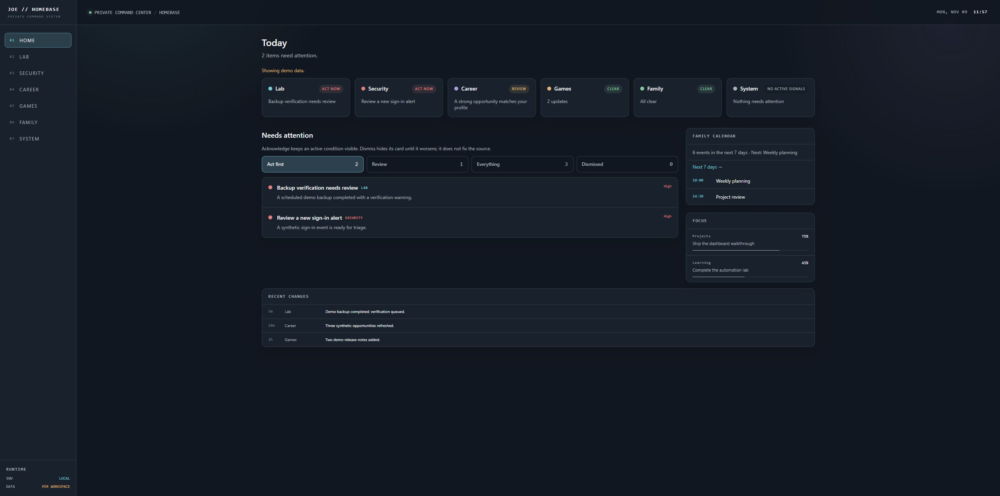
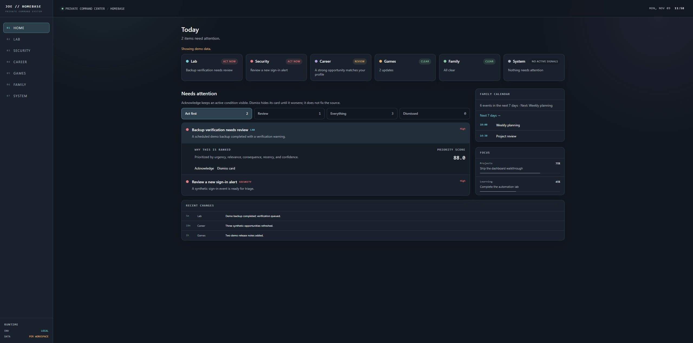

# Homebase screenshot tour

These are genuine browser captures of the Homebase web interface, not generated mockups. Captured on November 9, 2026 from the local source snapshot in a separate screenshot-only copy.

All events, alerts, counts, progress values, and activity shown are synthetic fixtures validated by the app's shared Home response schema. The interface visibly displays **Showing demo data.** No live integration, household calendar, production API, credential, or private deployment address was used. These demonstrate UI behavior, not current operational status.

## Dashboard overview

The Home view combines:
- Cross-domain status cards for Lab, Security, Career, Games, Family, and System.
- A ranked attention queue with Act first, Review, Everything, and Dismissed filters.
- A calendar outlook, focus progress, and recent changes.

## Explainable attention

Expanding a queue item reveals its explanation and priority score. The Acknowledge and Dismiss card controls are part of the real interface; no state-changing actions were performed for these captures. The displayed explanation and score are synthetic examples, not the result of a live event.

See the [source-backed feature walkthrough](FEATURE_WALKTHROUGH.md) for scoring and last-known-data code excerpts.

## Capture boundary

The UI layout and components were left intact. Only the copied API client was replaced with schema-validated fixture data for the Home response; other API destinations were redirected to an unused loopback port. The demo bound only to 127.0.0.1. Original source and live services were not changed.
