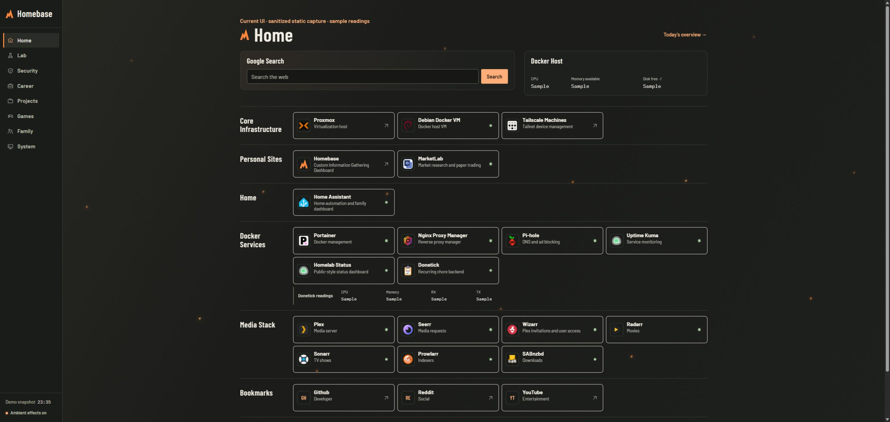
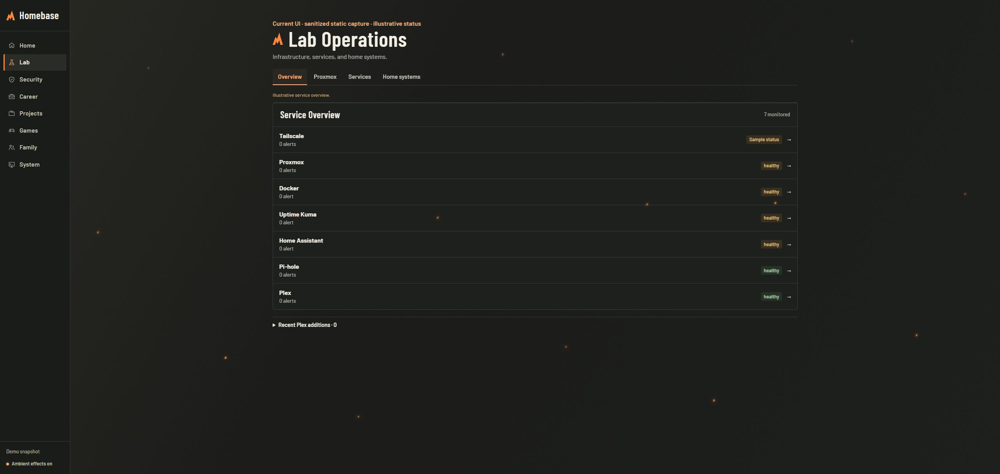

# Current Homebase interface

These screenshots show the deployed orange-and-charcoal Homebase interface inspected in November 2026. They replace the earlier blue Today-view tour, which came from an older local source snapshot.

## Home

The Home page brings together search, a Docker resource card, and grouped launcher tiles for infrastructure, personal sites, home services, Docker services, media, and bookmarks. The left sidebar provides access to Home, Lab, Security, Career, Projects, Games, Family, and System.

## Lab Operations

Lab Operations groups infrastructure, services, and home systems in one workspace. The overview shows monitored services, status indicators, alert counts, and navigation to Proxmox, Services, and Home systems.

## Capture and privacy notes

- These are browser-rendered screenshots of sanitized static copies of the current deployed pages, not generated mockups.
- The deployed page layout, styling, fonts, and icons were retained. Scripts and external connections were disabled in the isolated local capture.
- Private addresses were removed. Resource readings, health indicators, alert counts, and timestamps were replaced with sample values or labels.
- Green dots and healthy labels illustrate the design; they do not report actual service health.
- No live services or application records were modified.
- Only the final screenshot images are published, not the exported page markup or private deployment assets.
- The current deployed source revision has not been verified. This repository contains an earlier source snapshot; these screenshots do not imply that the checked-in source reproduces the current deployment.

For source-linked explanations of the code included in this repository, see the [feature walkthrough](FEATURE_WALKTHROUGH.md).
